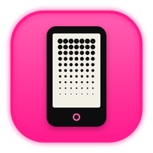

<h2 align="center">Krinik Custom CrossPoint</h2>

  
  &nbsp;
  

<b>KCCP — Krinik Custom CrossPoint, a custom build of CrossPoint Reader for the Xteink X4 Pro</b> 
The firmware, the reader setup and the research behind it — and the improvements that go back to CrossPoint

<i>❤️ Dedicated to my mother, Sofia Fadeevna Kryvusha — a great reader and lover of books, who gave me my love of reading.</i>

  
  
  
  
  

[Читать по-русски →](#russian)

> [!TIP]
> **Sister project — [KEINKT](https://github.com/MikalaiKryvusha/KEINKT), Krinik E-Ink Tools.** The two projects work as one:
> KEINKT Calibrator measures how your screen really shows grays from phone photos and gives KCCP the correction curve;
> KCCP draws the calibration cards, reads the curve and shows pictures and sleep screens through it.
> **[Open KEINKT Calibrator →](https://mikalaikryvusha.github.io/KEINKT/calibrator/)**

**This project exists to make CrossPoint better — for myself, for my beloved mother, and for the community.** We both read
on Xteink X4 Pro readers. What I fix and add for our two readers first lives in **KCCP**; what proves itself on the device
goes back to [CrossPoint Reader](https://github.com/crosspoint-reader/crosspoint-reader) as pull requests, so every
CrossPoint reader gets it.

**How it started.** With a single sleep-screen picture: I wanted it to look beautiful on the reader, so I set out to fit its
colours to how the e-ink screen really renders tones. That one picture grew into a firmware improved and developed in many
ways — and into contributions to the original CrossPoint.

  

The same pictures on the reader, calibration off and on. Photos of the real screen, one shared normalisation.

> **Built for the Xteink X4 Pro.** KCCP is developed and tested on the **Xteink X4 Pro** (panel controller UC8279).
> Other CrossPoint boards build from the same code; they are not tested by me.

### Roadmap

✅ — done and tested on the reader · 🛠 **DEBUG ONLY:** before a feature — a debugging aid in debug builds, not for release · 📝 **TO DO** — planned.
"debug → next" — done and tested in a debug build, goes into the next release.
Versions are KCCP versions; 1.0.0–1.1.1 were released under the old name *krinik*. Latest: **[KCCP 1.1.2](https://github.com/MikalaiKryvusha/Krinik-Custom-CrossPoint/releases/tag/kccp-1.1.2)**.

| Feature | Status | KCCP |
|---|---|---|
| Built-in panel tone curve; sleep screens are prepared flat, like for a computer (`panel_curve.txt` overrides it) | ✅ | 1.0.0 |
| White clean before the sleep screen — no page letters, no harsh frame | ✅ | 1.0.0 |
| Sleep image order: in order, random without repeats, or one picture; broken and truncated BMPs skipped | ✅ | 1.0.0 |
| Sleep image orientation: by the picture or one of four | ✅ | 1.0.0 |
| Footnote link opens the page where the note begins | ✅ | 1.0.0 |
| Book images in dark mode keep their tones (dithering) | ✅ | 1.0.0 |
| Lyra theme: book title up to 5 lines | ✅ | 1.0.0 |
| Delayed redraw of pictures and sleep screens — residual charge drains, ghosts fade | ✅ | 1.0.0 |
| No black bar under the menu header and no popups on sleep — fewer ghosts on gray | ✅ | 1.0.0 |
| Clean Home screen, clean after Control Center, menu redraw | ✅ | 1.0.0 |
| Home cover stays positive after a theme switch; Control Center over a picture in its own theme | ✅ | 1.0.0 |
| Picture viewer: BMP, JPG, PNG in gray through the curve, cache, round the folder, reader gestures, long tap rotates, "Set as sleep screen" | ✅ | 1.0.0 |
| Frontlight on sleep: the light holds over the fresh sleep screen and fades; a button cancels sleep | ✅ | 1.0.0 |
| Smooth frontlight on and off; frontlight parked before sleep | ✅ | 1.0.0 |
| Flashlight on the Home screen | ✅ | 1.0.0 |
| About: SoC flash, SD file system, total, used and free space | ✅ | 1.0.0 |
| "Check for updates" asks first, Cancel by default | ✅ | 1.0.0 |
| Russian UI with short labels; Classic theme: empty-cover text inside the frame | ✅ | 1.0.0 |
| Mom's build with the "For beloved Mom" item ❤️ | ✅ | 1.0.0 |
| Screen calibration: 33-step cards for pictures and books, curves from [KEINKT Calibrator](https://mikalaikryvusha.github.io/KEINKT/calibrator/), applied without a reboot | ✅ | 1.1.0 |
| Screen cleaning settings in one menu; redraw delay Off / 1 / 2 / 5 min for sleep screens and pictures | ✅ | 1.1.0 |
| Viewer: swipe from the left edge goes Back | ✅ | 1.1.0 |
| Back from the calibration screens goes straight to the calibration menu | ✅ | 1.1.1 |
| Calibration curves live in `/.crosspoint/` | ✅ | 1.1.1 |
| Anchor after an unavailable-image placeholder leads to its text | ✅ | 1.1.1 |
| Smooth frontlight from the current brightness, also at low levels; one animation for wake, flashlight and sleep | ✅ | 1.1.2 |
| Cold and warm channels computed separately with fractional values; 11-bit PWM at 39 kHz | ✅ | 1.1.2 |
| Precise temperature: dithering only at low brightness | ✅ | debug&nbsp;→&nbsp;next |
| 🛠&nbsp;**DEBUG&nbsp;ONLY**: Battery log every 20 minutes | ✅ | debug4 |
| "Sleep" item in the Home menu | ✅ | debug&nbsp;→&nbsp;next |
| "Sleep" on Home shows its selection before the sleep starts | ✅ | debug8 |
| Sleep-screen redraw timed from the sleep; a press that does not wake no longer shifts or cancels it | ✅ | debug7 |
| Light lingering at sleep: with Short Power Button ≠ Sleep only a hold cancels the sleep, a click does not | ✅ | debug7 |

| Planned | Status |
|---|---|
| Rename the firmware krinik → KCCP (version string, build names, releases) | 📝&nbsp;**TO&nbsp;DO** |
| Precise temperature: dithering only at brightness ≤ 9 %, off at 10 % | 📝&nbsp;**TO&nbsp;DO** |
| Configurable Control Center: add Sleep and Flashlight, hide Bluetooth or Clean | 📝&nbsp;**TO&nbsp;DO** |
| "Unplug the charger" reminder at a chosen battery level | 📝&nbsp;**TO&nbsp;DO** |
| Own voltage → percent battery scale for the X4 Pro | 📝&nbsp;**TO&nbsp;DO** |
| True gray book images in dark mode (now dithering) | 📝&nbsp;**TO&nbsp;DO** |
| Correct screenshots in dark mode | 📝&nbsp;**TO&nbsp;DO** |
| File dates from the reader's clock | 📝&nbsp;**TO&nbsp;DO** |
| Option to update from KCCP releases instead of the official CrossPoint ones | 📝&nbsp;**TO&nbsp;DO** |
| Gray without ghosts: do not keep the sharp header line in one place, show its inversion from time to time | 📝&nbsp;**TO&nbsp;DO** |
| Mom's build: fit the 8-row Home menu on the screen | 📝&nbsp;**TO&nbsp;DO** |
| Russian translation with short labels — as a pull request to CrossPoint | 📝&nbsp;**TO&nbsp;DO** |
| LED driver: current and ratings of the frontlight | 📝&nbsp;**TO&nbsp;DO** |

Latest release — **[KCCP 1.1.2](https://github.com/MikalaiKryvusha/Krinik-Custom-CrossPoint/releases/tag/kccp-1.1.2)**, all releases with images and SHA256 sums —
[Releases](https://github.com/MikalaiKryvusha/Krinik-Custom-CrossPoint/releases). The reader is flashed from the SD card:
**Settings → System → Update from SD card**. Inside the 1.1.2 image the name is still `cp-2.0.0-krinik-1.1.2`; it becomes KCCP in the
next version.

### Contribution to CrossPoint

| PR | What | State |
|---|---|---|
| [#4329](https://github.com/crosspoint-reader/crosspoint-reader/pull/4329) | Recent-book cover stays positive after a theme switch | ✅&nbsp;merged |
| [#4330](https://github.com/crosspoint-reader/crosspoint-reader/pull/4330) | Empty-cover text stays inside the frame (Classic) | ✅&nbsp;merged |
| [#4331](https://github.com/crosspoint-reader/crosspoint-reader/pull/4331) | SD card size, used and free space in About | ✅&nbsp;merged |
| [#4328](https://github.com/crosspoint-reader/crosspoint-reader/pull/4328) | Footnote link opens the page of the note's first line | 💡&nbsp;open |
| [#4332](https://github.com/crosspoint-reader/crosspoint-reader/pull/4332) | Sleep Image Order: Random or In Order | 💡&nbsp;open |
| [#4375](https://github.com/crosspoint-reader/crosspoint-reader/pull/4375) | Screen cleaning settings grouped | 💡&nbsp;open |
| [#4376](https://github.com/crosspoint-reader/crosspoint-reader/pull/4376) | Optional delayed image redraws | 💡&nbsp;open |
| [#4377](https://github.com/crosspoint-reader/crosspoint-reader/pull/4377) | Calibrate picture and book image tones | 💡&nbsp;open |

### Our documents

| Document | What it is |
|---|---|
| [**РУКОВОДСТВО.epub**](РУКОВОДСТВО.epub) | The guide to every KCCP setting, in Russian, as a book: put it on the card and read it on the reader. Edition 1.1.2 |
| [**КАЛИБРОВКА.epub**](КАЛИБРОВКА.epub) | A calibration book: a 0–100 % gray scale and test pictures in several shadow corrections — how the screen renders tones inside a book |

### What is in this repo

The firmware code lives in the fork [MikalaiKryvusha/crosspoint-reader](https://github.com/MikalaiKryvusha/crosspoint-reader)
(SDK: [MikalaiKryvusha/freeink-sdk](https://github.com/MikalaiKryvusha/freeink-sdk)). This repo holds everything around it:

- `restore.mjs`, `settings.json`, `fonts/`, `РУКОВОДСТВО.epub`, `КАЛИБРОВКА.epub` — set up a reader exactly like ours in one
  command (guide in Russian: [`legacy/README.ru.md`](legacy/README.ru.md));
- `firmware-builds/` — KCCP images with SHA256 sums;
- `tools/` — fonts, covers, sleep screens, footnote fixers for EPUB;
- `researches/`, `qa_runs/` — measurements, test evidence, pull-request preparation.

State and next steps — [`STATUS.md`](STATUS.md).

### Thanks

To **[Uri Tauber](https://github.com/Uri-Tauber)** and **[Justin Mitchell](https://github.com/itsthisjustin)**, maintainers of
CrossPoint Reader, for allowing me to contribute to their project and bring benefit to the whole community of readers, for
their reviews and merged pull requests — and to everyone who builds CrossPoint: without your firmware there would be nothing
to improve. ❤️

### Licence

MIT — see [LICENSE](LICENSE), the same licence as the original CrossPoint code. Exceptions keep their own terms: fonts in
`fonts/` — SIL Open Font License ([OFL.txt](fonts/OFL.txt)); firmware images in `firmware-builds/` — GPLv3, like every
CrossPoint firmware executable (it includes wolfSSL), with the source in the
[fork](https://github.com/MikalaiKryvusha/crosspoint-reader).

---

<h2 align="center">Krinik Custom CrossPoint</h2>

  
  &nbsp;
  

<b>KCCP — Krinik Custom CrossPoint, своя сборка CrossPoint Reader для Xteink X4 Pro</b> 
Прошивка, настройка читалки и исследования за ними — и улучшения, которые возвращаются в CrossPoint

<i>❤️ Проект посвящён моей маме — Кривуше Софии Фадеевне, очень большому читателю-книголюбу, которая привила мне любовь к чтению книг.</i>

  
  
  
  
  

[Read in English →](#english)

> [!TIP]
> **Проект-побратим — [KEINKT](https://github.com/MikalaiKryvusha/KEINKT), Krinik E-Ink Tools.** Два проекта работают как
> одно целое: KEINKT Calibrator по фото с телефона измеряет, как ваш экран на самом деле показывает серое, и даёт KCCP кривую
> поправки; KCCP рисует калибровочные карточки, читает кривую и показывает через неё картинки и заставки сна.
> **[Открыть KEINKT Calibrator →](https://mikalaikryvusha.github.io/KEINKT/calibrator/)**

**Проект призван улучшить CrossPoint — для себя, для любимой мамы и для сообщества.** Мы оба читаем на Xteink X4 Pro.
То, что я исправляю и добавляю для наших двух читалок, сначала живёт в **KCCP**; то, что проверено на устройстве, уходит
в [CrossPoint Reader](https://github.com/crosspoint-reader/crosspoint-reader) пулл-реквестами, чтобы это получил каждый, кто
читает на CrossPoint.

**Как всё началось.** С одной картинки на заставке сна: хотелось, чтобы она красиво смотрелась на читалке, и я взялся
подогнать её цвета под то, как экран на самом деле передаёт тона. Из этой картинки выросла прошивка, улучшенная и развитая
во многих аспектах, — и вклад в оригинальный CrossPoint.

  

Одни и те же картинки на читалке, калибровка выключена и включена. Фото настоящего экрана, одна общая нормализация.

> **Сделано под Xteink X4 Pro.** KCCP разрабатывается и тестируется на **Xteink X4 Pro** (контроллер панели UC8279).
> Другие платы CrossPoint собираются из того же кода, но я их не тестирую.

### Дорожная карта

✅ — сделано и проверено на читалке · 🛠 **ТОЛЬКО ДЛЯ ОТЛАДКИ:** перед фичей — инструмент отладки в отладочных сборках, не для релиза · 📝 **TO DO** — в планах.
«debug → след.» — сделано и проверено в отладочной сборке, войдёт в следующий релиз.
Версии — версии KCCP; 1.0.0–1.1.1 выпускались под прежним именем *krinik*. Последняя: **[KCCP 1.1.2](https://github.com/MikalaiKryvusha/Krinik-Custom-CrossPoint/releases/tag/kccp-1.1.2)**.

| Фича | Статус | KCCP |
|---|---|---|
| Встроенная кривая тонов панели; заставки готовятся ровными, как для компьютера (`panel_curve.txt` её заменяет) | ✅ | 1.0.0 |
| Очистка в белый перед заставкой сна — без букв страницы и резкого кадра | ✅ | 1.0.0 |
| Порядок заставок сна: по порядку, случайно без повторов или одна картинка; битые и обрезанные BMP пропускаются | ✅ | 1.0.0 |
| Ориентация заставки сна: по картинке или одна из четырёх | ✅ | 1.0.0 |
| Ссылка на сноску открывает страницу, где сноска начинается | ✅ | 1.0.0 |
| Картинки в книге в тёмной теме сохраняют тона (дизеринг) | ✅ | 1.0.0 |
| Тема Lyra: название книги до 5 строк | ✅ | 1.0.0 |
| Отложенная перерисовка картинок и заставок — остаточный заряд стекает, призраки уходят | ✅ | 1.0.0 |
| Без чёрной полосы под заголовком меню и без попапов при засыпании — меньше призраков на сером | ✅ | 1.0.0 |
| Очищать главный экран, очищать после шторки, перерисовка меню | ✅ | 1.0.0 |
| Обложка на главном не уходит в негатив после смены темы; шторка над фото — в своей теме | ✅ | 1.0.0 |
| Просмотр картинок: BMP, JPG, PNG в сером через кривую, кэш, по кругу, жесты как в книге, долгий тап поворачивает, «На экран сна» | ✅ | 1.0.0 |
| Подсветка на засыпании: свет держится над свежей заставкой и плавно гаснет; кнопка отменяет сон | ✅ | 1.0.0 |
| Плавное включение и выключение подсветки; подсветка паркуется перед сном | ✅ | 1.0.0 |
| Фонарик на главном экране | ✅ | 1.0.0 |
| «Об устройстве»: SoC Flash, файловая система SD, объём, занято и свободно | ✅ | 1.0.0 |
| «Проверить обновление» сначала спрашивает, по умолчанию «Отмена» | ✅ | 1.0.0 |
| Русский интерфейс с короткими подписями; тема Classic: текст пустой обложки в рамке | ✅ | 1.0.0 |
| Мамина сборка с пунктом «Для любимой Мамы» ❤️ | ✅ | 1.0.0 |
| Калибровка экрана: карточки из 33 ступеней для картинок и книг, кривые из [KEINKT Calibrator](https://mikalaikryvusha.github.io/KEINKT/calibrator/), без перезагрузки | ✅ | 1.1.0 |
| Настройки очисток экрана в одном меню; перерисовка заставки и картинок ВЫКЛ / 1 / 2 / 5 мин | ✅ | 1.1.0 |
| Просмотр картинок: свайп от левого края — «Назад» | ✅ | 1.1.0 |
| «Назад» из калибровочных экранов сразу в меню калибровки | ✅ | 1.1.1 |
| Кривые калибровки хранятся в `/.crosspoint/` | ✅ | 1.1.1 |
| Якорь после заглушки недоступной картинки ведёт к своему тексту | ✅ | 1.1.1 |
| Плавная подсветка с текущей яркости, в том числе на малых значениях; одна анимация для пробуждения, фонарика и сна | ✅ | 1.1.2 |
| Холодный и тёплый каналы раздельно с дробными значениями; 11-битный ШИМ на 39 кГц | ✅ | 1.1.2 |
| Точная температура: дизеринг только на малой яркости | ✅ | debug&nbsp;→&nbsp;след. |
| 🛠&nbsp;**ТОЛЬКО&nbsp;ДЛЯ&nbsp;ОТЛАДКИ**: Лог батареи раз в 20 минут | ✅ | debug4 |
| Пункт «Сон» в главном меню | ✅ | debug&nbsp;→&nbsp;след. |
| «Сон» на главном экране выделяется до начала сна | ✅ | debug8 |
| Перерисовка заставки отсчитывается от ухода в сон; нажатие, которое не будит, её не сдвигает и не отменяет | ✅ | debug7 |
| Подсветка на засыпании: при «Короткое нажатие PWR» не «Сон» сон отменяет только удержание, щелчок — нет | ✅ | debug7 |

| В планах | Статус |
|---|---|
| Переименовать прошивку krinik → KCCP (строка версии, имена сборок, релизы) | 📝&nbsp;**TO&nbsp;DO** |
| Точная температура: дизеринг только при яркости ≤ 9 %, на 10 % выключен | 📝&nbsp;**TO&nbsp;DO** |
| Настраиваемая шторка: добавить Сон и Фонарик, скрывать Bluetooth или Очистку | 📝&nbsp;**TO&nbsp;DO** |
| Напоминание «отключи зарядку» на выбранном уровне заряда | 📝&nbsp;**TO&nbsp;DO** |
| Своя шкала «напряжение → процент» для X4 Pro | 📝&nbsp;**TO&nbsp;DO** |
| Настоящие серые картинки в книге в тёмной теме (сейчас дизеринг) | 📝&nbsp;**TO&nbsp;DO** |
| Верные снимки экрана в тёмной теме | 📝&nbsp;**TO&nbsp;DO** |
| Даты файлов от часов читалки | 📝&nbsp;**TO&nbsp;DO** |
| Опция обновления из релизов KCCP, а не из официальных CrossPoint | 📝&nbsp;**TO&nbsp;DO** |
| Серый без призраков: не держать резкую линию заголовка на одном месте, иногда показывать её инверсию | 📝&nbsp;**TO&nbsp;DO** |
| Мамина сборка: главное меню из 8 строк помещается на экран | 📝&nbsp;**TO&nbsp;DO** |
| Русский перевод с короткими подписями — пулл-реквестом в CrossPoint | 📝&nbsp;**TO&nbsp;DO** |
| Драйвер подсветки: ток и номиналы светодиодов | 📝&nbsp;**TO&nbsp;DO** |

Последний релиз — **[KCCP 1.1.2](https://github.com/MikalaiKryvusha/Krinik-Custom-CrossPoint/releases/tag/kccp-1.1.2)**, все релизы с образами и суммами SHA256 —
[Releases](https://github.com/MikalaiKryvusha/Krinik-Custom-CrossPoint/releases). Читалка прошивается с SD-карты:
**Настройки → Система → Обновление системы с SD-карты**. Внутри образа 1.1.2 имя пока `cp-2.0.0-krinik-1.1.2`; на KCCP оно сменится в
следующей версии.

### Вклад в CrossPoint

| PR | Что | Состояние |
|---|---|---|
| [#4329](https://github.com/crosspoint-reader/crosspoint-reader/pull/4329) | Обложка последней книги остаётся позитивной после смены темы | ✅&nbsp;принят |
| [#4330](https://github.com/crosspoint-reader/crosspoint-reader/pull/4330) | Текст пустой обложки не выходит за рамку (Classic) | ✅&nbsp;принят |
| [#4331](https://github.com/crosspoint-reader/crosspoint-reader/pull/4331) | Объём, занятое и свободное место SD-карты в «Об устройстве» | ✅&nbsp;принят |
| [#4328](https://github.com/crosspoint-reader/crosspoint-reader/pull/4328) | Ссылка на сноску открывает страницу её первой строки | 💡&nbsp;открыт |
| [#4332](https://github.com/crosspoint-reader/crosspoint-reader/pull/4332) | Порядок заставок сна: случайно или по порядку | 💡&nbsp;открыт |
| [#4375](https://github.com/crosspoint-reader/crosspoint-reader/pull/4375) | Настройки очисток экрана в одном меню | 💡&nbsp;открыт |
| [#4376](https://github.com/crosspoint-reader/crosspoint-reader/pull/4376) | Отложенная перерисовка картинок | 💡&nbsp;открыт |
| [#4377](https://github.com/crosspoint-reader/crosspoint-reader/pull/4377) | Калибровка тонов картинок и иллюстраций в книгах | 💡&nbsp;открыт |

### Наши документы

| Документ | Что это |
|---|---|
| [**РУКОВОДСТВО.epub**](РУКОВОДСТВО.epub) | Руководство по всем настройкам KCCP — книгой: положите на карту и читайте на читалке. Издание 1.1.2 |
| [**КАЛИБРОВКА.epub**](КАЛИБРОВКА.epub) | Калибровочная книга: шкала серого 0–100 % и тестовые картинки в нескольких поправках теней — как экран передаёт тона внутри книги |

### Что в этом репозитории

Код прошивки — в форке [MikalaiKryvusha/crosspoint-reader](https://github.com/MikalaiKryvusha/crosspoint-reader)
(SDK: [MikalaiKryvusha/freeink-sdk](https://github.com/MikalaiKryvusha/freeink-sdk)). Здесь — всё вокруг неё:

- `restore.mjs`, `settings.json`, `fonts/`, `РУКОВОДСТВО.epub`, `КАЛИБРОВКА.epub` — настроить читалку точно как наша одной
  командой (инструкция: [`legacy/README.ru.md`](legacy/README.ru.md));
- `firmware-builds/` — образы KCCP с суммами SHA256;
- `tools/` — шрифты, обложки, заставки сна, починка сносок в EPUB;
- `researches/`, `qa_runs/` — замеры, доказательства проверок, подготовка пулл-реквестов.

Состояние и следующие шаги — [`STATUS.md`](STATUS.md).

### Благодарности

**[Ури Таубер](https://github.com/Uri-Tauber)** и **[Джастину Митчеллу](https://github.com/itsthisjustin)**, мейнтейнерам
CrossPoint Reader, — за то, что позволили внести вклад в их проект и принести пользу всему сообществу читателей, за ревью и
принятые пулл-реквесты. И всем, кто делает CrossPoint: без вашей прошивки нечего было бы улучшать. ❤️

### Лицензия

MIT — см. [LICENSE](LICENSE), та же лицензия, что у оригинального кода CrossPoint. Исключения со своими условиями: шрифты в
`fonts/` — SIL Open Font License ([OFL.txt](fonts/OFL.txt)); образы прошивки в `firmware-builds/` — GPLv3, как любой
исполняемый файл прошивки CrossPoint (в нём wolfSSL), исходники — в [форке](https://github.com/MikalaiKryvusha/crosspoint-reader).
