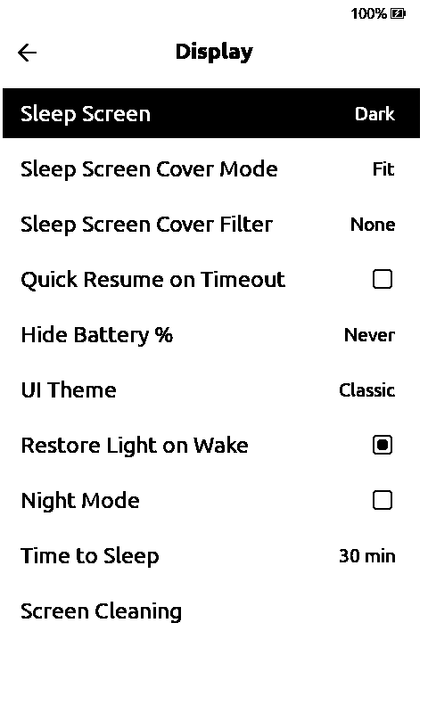
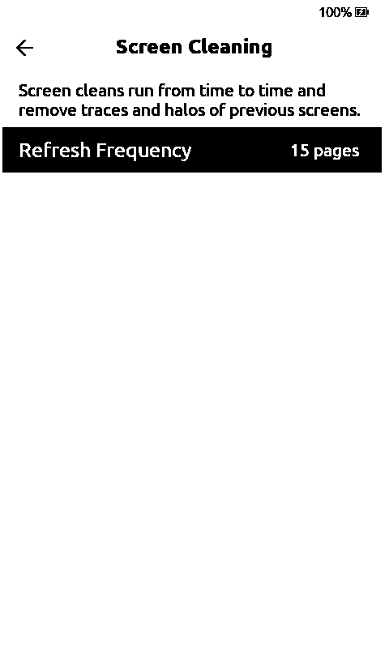
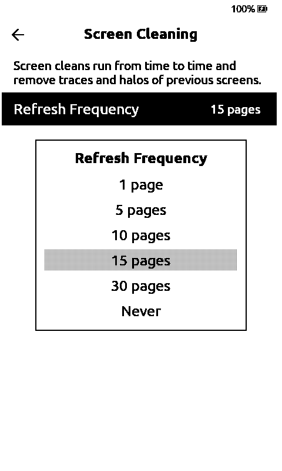

# Group screen refresh settings under Screen Cleaning

Display mixes sleep, appearance and screen maintenance options. This adds **Settings → Display → Screen Cleaning**, with a short explanation, and moves the existing **Refresh Frequency** and **Sunlight Fading Fix** options there.

Saved values, JSON keys and web settings stay compatible. Sunlight Fading Fix keeps its existing board restrictions. No new refresh behavior is enabled.

| Display | Screen Cleaning | Refresh Frequency |
| --- | --- | --- |
|  |  |  |

Checked with C3 `default`, X4 Pro `x4pro-gh_release`, and the desktop simulator. In English and Russian: open the submenu, change Refresh Frequency, check the saved value, and return through Display → Settings → Home. Physical-panel timing is not inferred from the simulator.
