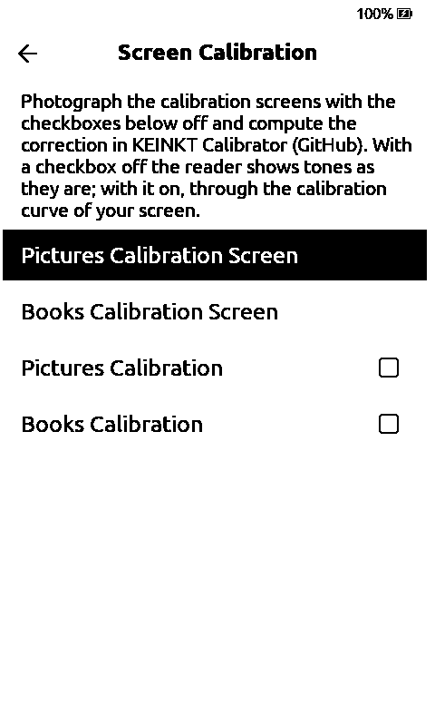
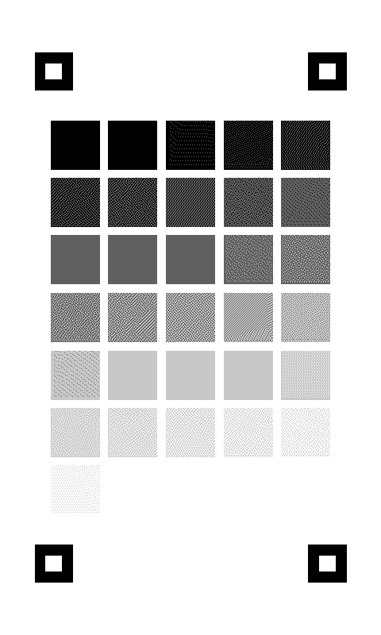
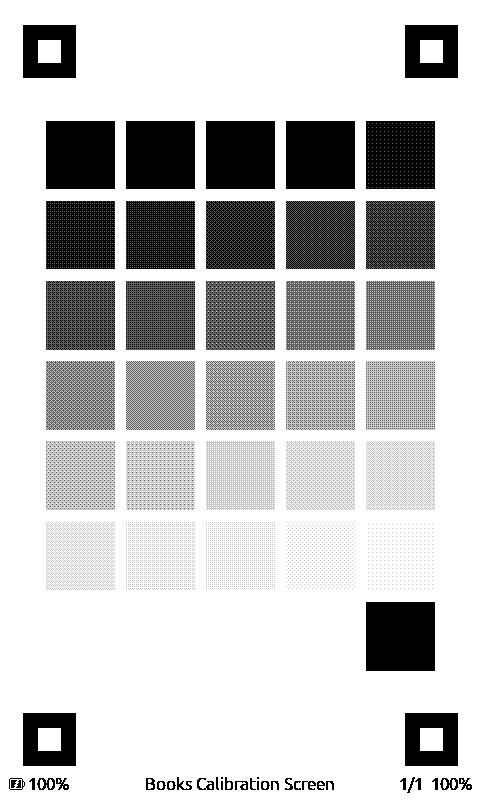
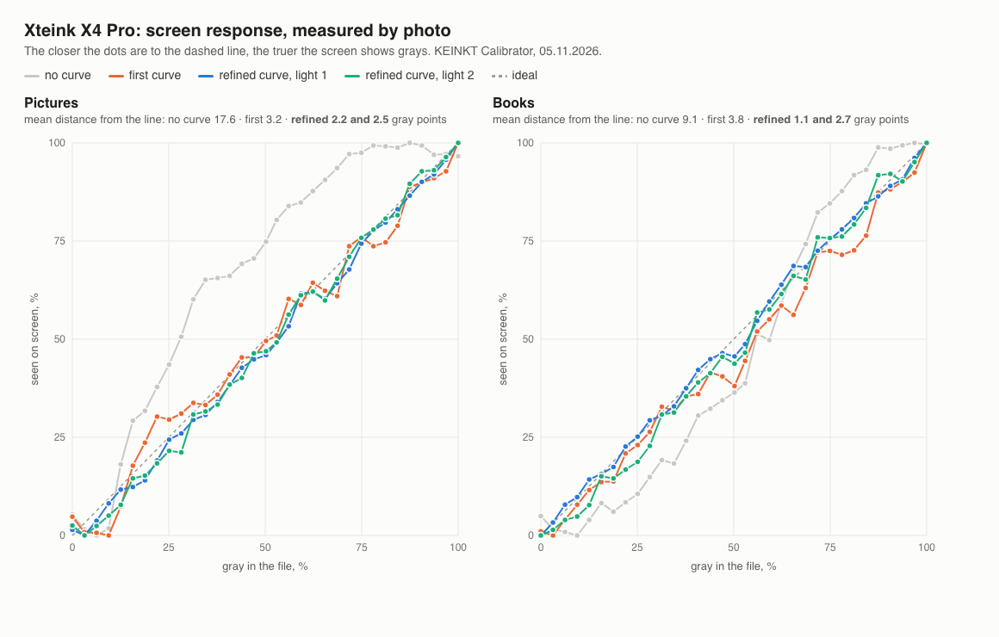
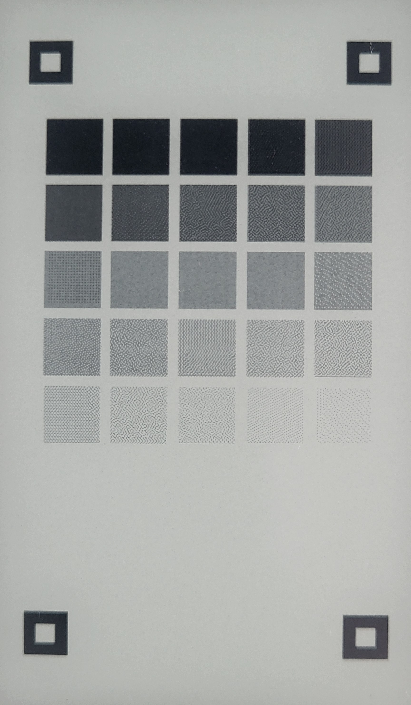
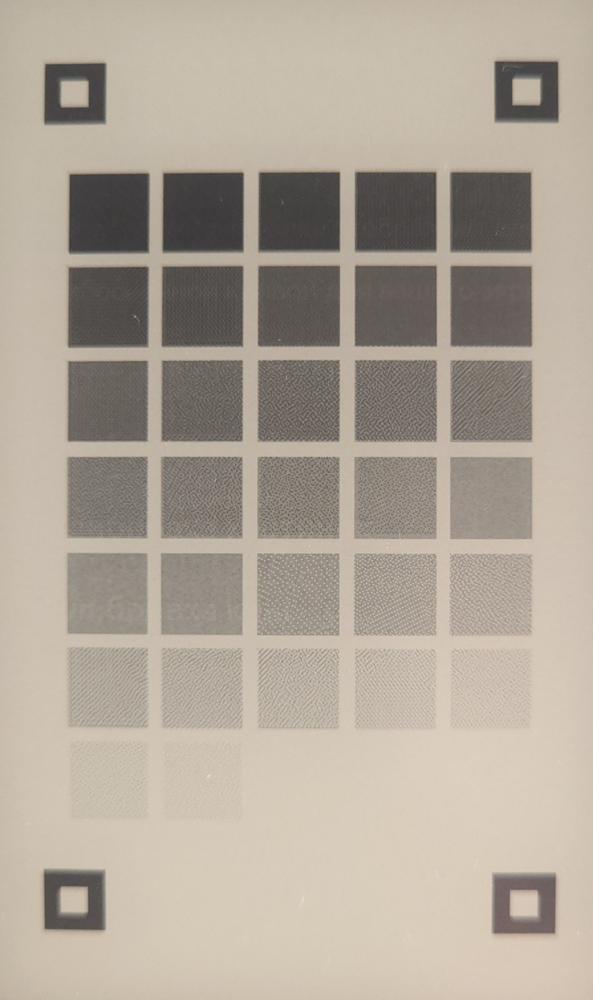
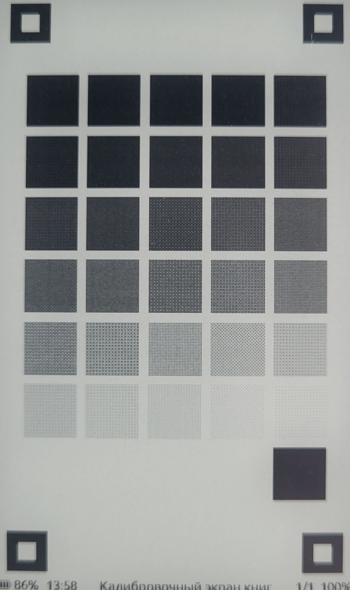
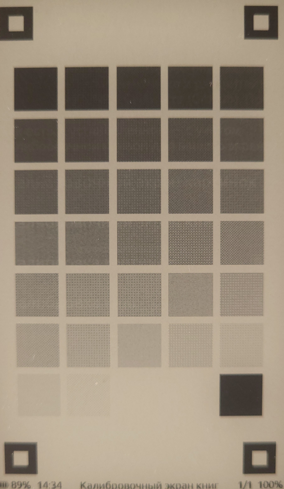

# Add separate screen calibration for pictures and book images

The same gray image can look different on an e-ink panel and in the two rendering paths. Add **Display → Screen Calibration** with generated pictures/books targets and separate optional SD tone curves. [KEINKT Calibrator](https://mikalaikryvusha.github.io/KEINKT/calibrator/) measures the targets from phone photographs.

| Screen Calibration | Pictures target | Books target |
| --- | --- | --- |
|  |  |  |

Both checkboxes default to Off. Store `panel_curve.txt` and `panel_curve_book.txt` under `/.crosspoint/`; a checkbox reloads its curve immediately. Missing or invalid files leave tones unchanged. No curve measured on someone else's panel is built in. Back returns directly to the calibration menu; the targets do not replace the resumed book or enter Recent books.

| Pictures: before | Pictures: refined curve |
| --- | --- |
|  |  |

| Books: before | Books: refined curve |
| --- | --- |
|  |  |

These are real photographs of one X4 Pro, cropped without tone edits. Lighting and exposure vary between photographs; the graph uses the measured, normalized response.

Validation: 912 host tests; C3 and X4 Pro builds; eight simulator Back scenarios across both cards and all reading orientations; a small BMP retains its dimensions with calibration Off/On(identity). The simulator needed local HAL compatibility fixes; they are not firmware changes. This upstream port still needs its own hardware check before opening the PR.
