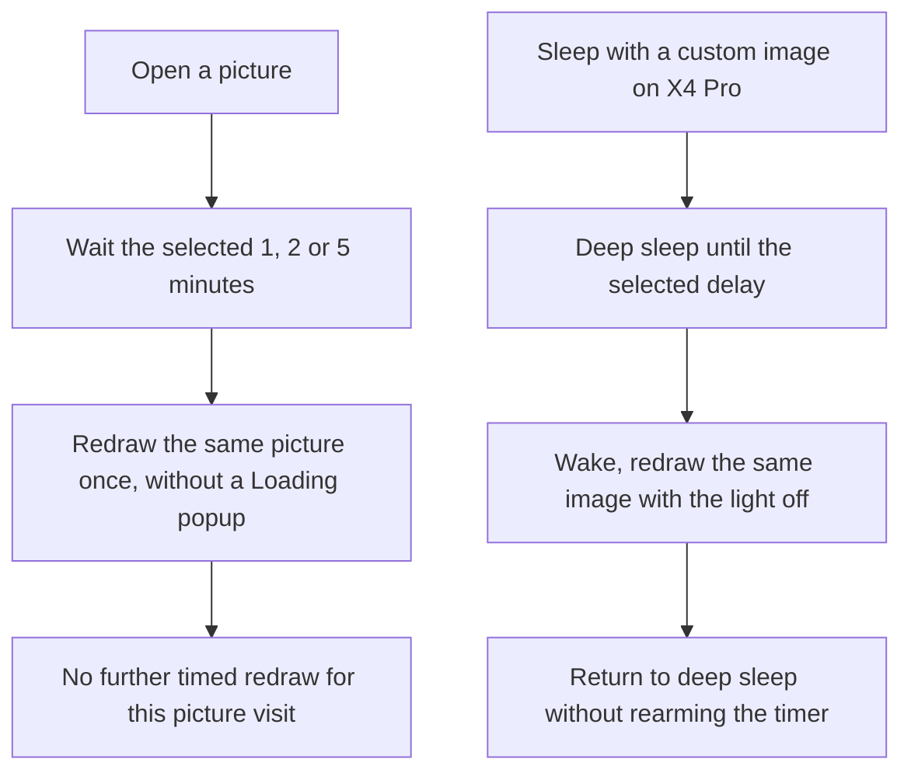

## Summary

**Reduce ghosting from previous screens on pictures and sleep images.** On my X4 Pro, a gray image can retain outlines of menu text, headers, or other content shown just before it. Repainting immediately did not remove those traces in my experiments; waiting and then repainting the same image did. This PR makes that delayed repaint optional and automatic.

This is separate from **Refresh Frequency**, which controls full refreshes while turning book pages. A picture left open, or a sleeping reader, does not turn pages and needs its own trigger. See also the ghosting reports in #4154; this PR addresses delayed picture/sleep-image redraws, not every menu-ghosting case in that issue.

### Settings

Under **Settings → Display → Screen Cleaning** from #4375:

| Option | Where | Values | Default |
| --- | --- | --- | --- |
| **Refresh Images** | Image viewer | Off / after 1 / 2 / 5 min | Off |
| **Refresh Sleep Screen** | Custom sleep images on X4 Pro | Off / after 1 / 2 / 5 min | Off |

| Screen Cleaning | Sleep-screen delay | Image-viewer delay |
| --- | --- | --- |
|  |  |  |

*Screenshots captured from this PR's X4 Pro simulator. They show the controls, not the physical panel's ghosting.*

### How it works

* Opening another image starts a new image-viewer delay. Leaving the viewer ends that visit.
* The sleep redraw keeps the same image instead of selecting the next one. The normal power-button wake remains available.
* Quick Resume, panic recovery, a battery level below 15%, and a missing or overlong custom-image path do not arm the sleep redraw. A failed timer setup also leaves it unarmed.
* No controller waveform or SDK change is included. Both options are Off by default.

## Scope Check

- [x] I have read SCOPE.md and ROADMAP.md.
- [x] This PR is **not** a new built-in theme.
- [x] This PR is **not** a new external network connector.
- [x] This PR is **not** an interactive app, writing tool, RSS/news/browser, media playback, or PDF feature.
- [x] The stock firmware does not already handle this well, **and** no other popular CrossPoint fork already does.
- [x] This PR does not touch `freeink-sdk/`, `lib/hal/`, the bootloader, OTA, or recovery code.

## Additional Context

**Dependency:** #4375 adds the Screen Cleaning submenu. Merge it first. This branch includes that commit, so its changes also appear here until it is merged. The delayed-redraw change itself is commit `d7cc4e83`.

**Checks on `d7cc4e83`:** C3 `default`, `x4pro-gh_release` and simulator builds passed. In the simulator, a 60-second setting produced one redraw during 126 seconds; 40 swipes reopened the viewer 41 times without errors.

The delayed-redraw approach was tried on my X4 Pro in my personal build. The exact upstream port's sleep-timer wake and power-button interaction during redraw have not yet been checked on hardware. Simulator images illustrate the controls; they do not reproduce physical e-ink ghosting or demonstrate its removal. No power-consumption measurement is claimed.

---

### AI Usage

Did you use AI tools to help write this code? _**YES**_
