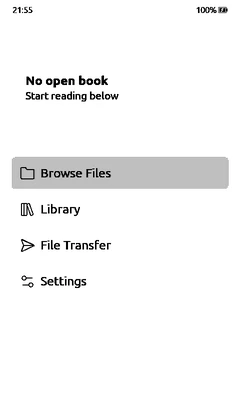
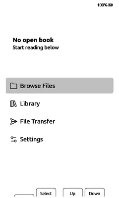
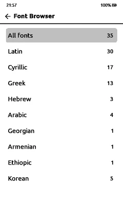
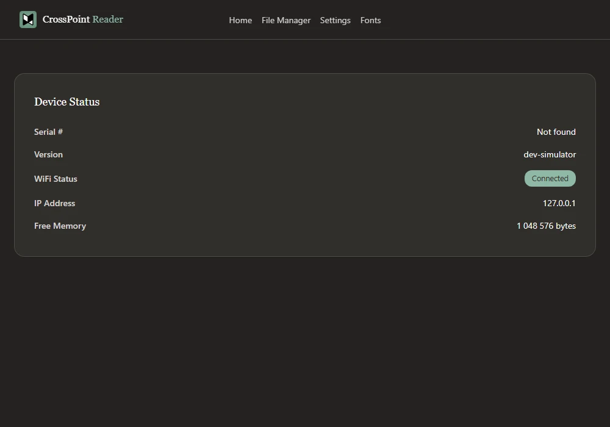
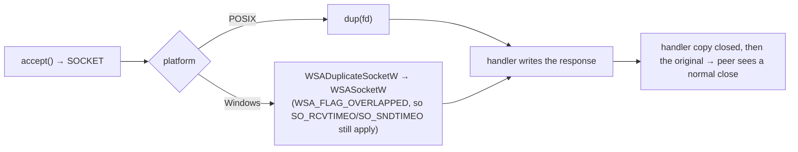
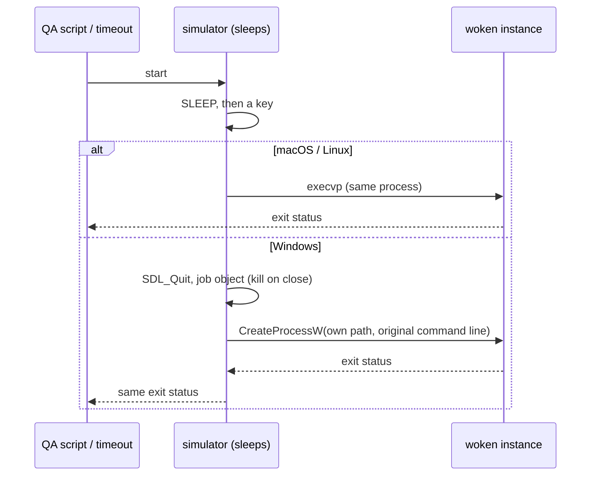

## Summary

**Build and run the simulator natively on Windows**, with the MSYS2 UCRT64 toolchain (gcc, SDL2, OpenSSL) and no WSL. Until now the README said "Native Windows is not supported; use WSL". With this PR the same firmware builds into a Windows `program.exe` that boots, takes scripted input and screenshots, serves the web manager, fetches over HTTPS through `curl`, and relaunches after sleep, as on macOS and Linux.

Every platform change is behind `_WIN32`. Outside it there are only two thin wrappers (`simCloseSocket()` = `close()`, `simDupSocket()` = `dup()`), curl's `-w` argument passed through the existing `shellQuote()`, and three opt-in window variables, so macOS and Linux behave as before.

| X4 Pro | X4 | File Transfer → Hotspot | Manage Fonts over HTTPS |
| --- | --- | --- | --- |
|  |  |  |  |

*Screens from the simulator's own screenshot hook on Windows 11, firmware `develop` `f8db833f`; the browser shot is headless Edge on `http://127.0.0.1:8080/`.*

## What changed

| Area | File | On Windows | On macOS / Linux |
| --- | --- | --- | --- |
| Sockets | `src/lwip/sockets.h` | Winsock behind the lwip names: one `WSAStartup()`, `send`/`recv`/`setsockopt` overloads for byte pointers and `timeval` timeouts, `fcntl(O_NONBLOCK)`, `SHUT_*` → `SD_*`; `<windows.h>` names that collide with firmware identifiers kept out (`Sleep()` renamed while Winsock is read; `IGNORE`, `ERROR`, `DELETE` and similar undefined) | unchanged; adds `simCloseSocket()` = `close()`, `simDupSocket()` = `dup()` |
| Web server | `src/WebServer.cpp` | the handler's client is a Winsock duplicate (`simDupSocket()`) | same `dup()` as before |
| POSIX bits | `src/SimPosixCompat.h` | `mkdir(path, mode)`, `fsync`, `O_BINARY` on every `open()`, `setenv`/`unsetenv` over `_putenv_s` | not included |
| HTTP | `src/SimHttpFetch.h` | temp file in `%TEMP%`, `cmd.exe` quoting, no `sys/wait.h` | `-w` argument now through `shellQuote()` |
| Storage | `src/HalStorage.cpp` | free/used space via `std::filesystem::space()`; `replaceFile()` removes the old file first, as the device does (`rename()` cannot overwrite on Windows) | same results |
| Sleep/wake | `src/SimulatorLifecycle.cpp` | relaunch with `CreateProcessW`, wait, exit with the child's status | `execvp`, unchanged |
| Window | `src/HalDisplay.cpp` | per-monitor DPI awareness before `SDL_Init` | – |
| Window (all) | `src/HalDisplay.cpp` | `CROSSPOINT_SIM_WINDOW_POS`, `_PERCENT`, `_BORDERLESS` | same, opt-in |
| Misc | `src/Arduino.h`, `MD5Builder` | `strlcpy`; `settimeofday()` → `EPERM`; OpenSSL MD5 path | unchanged |
| Docs | `README.md`, `sample-platformio-windows.ini` | MSYS2 setup, PATH, `PYTHONUTF8`, the sample env | – |

### Two Windows-only traps worth a closer look

**1. `dup()` of a socket.** The web server hands each request's handler a `NetworkClient(dup(client))`. On Windows the accepted value is a Winsock `SOCKET`, not a C-runtime descriptor, so `dup()` fails and everything the handler writes is lost. The server logged `Served root page` while the browser got *Empty reply from server*. `simDupSocket()` duplicates through Winsock instead:

**2. `exec` does not replace the process.** A deep-sleep wake relaunches the simulator. On Windows `_execvp` starts a new process and ends the current one, so anything waiting on the simulator (a QA script, `timeout`, CI) returned before the woken instance ran, and lost its exit status:

The woken instance gets the original command line, so quoted paths with spaces and non-ASCII user names survive. A kill-on-close job ends woken instances if the waiting one is killed (for example by a CI timeout), so no window is left behind.

## Building on Windows

1. Install MSYS2 and, in the UCRT64 shell: `pacman -S mingw-w64-ucrt-x86_64-{gcc,SDL2,openssl,pkgconf}`.
2. Put `C:\msys64\ucrt64\bin` first in `PATH` (gcc and `SDL2.dll`), and set `PYTHONUTF8=1` so the firmware's Python build scripts write UTF-8.
3. Use `sample-platformio-windows.ini` as the firmware's `platformio.local.ini` and run, for example, `pio run -e simulator_x4_pro`.

The sample has the same envs as the Linux one, with MSYS2 paths, Winsock and three workarounds:

| Flag | Why |
| --- | --- |
| `-std=gnu17` | gcc 15+ defaults C to C23, where `bool` is a keyword, and QRCode's `qrcode.h` typedefs it (g++ ignores the flag for C++) |
| `-include stdint.h` | MinGW does not bring in `<stdint.h>` transitively where glibc and libc++ do |
| `-Dmemcpy_P=memcpy` | AnimatedGIF maps `memcpy_P` only for `__MACH__`, `__LINUX__` and ESP32 |

## Testing

Windows 11 (10.0.26200), MSYS2 gcc 16.2.0, SDL2 2.32.10, OpenSSL 3.6.5, PlatformIO 6.2.0. Firmware `develop` `f8db833f` for the builds, the screenshots, the web manager test and HTTPS; the File Transfer, sleep/wake, exit-status and kill checks ran on a downstream firmware build with the same simulator code.

| Check | Result |
| --- | --- |
| `sample-platformio-windows.ini` as written (MSYS2 path and the local simulator checkout substituted, as the #60 CI does) → `simulator_x4_pro` | ✅ builds, boots to Home, web manager test 8/8 |
| X4 Pro and X4 envs | ✅ both build and boot |
| Boot to Home, scripted keys and taps, `WAIT`, `SHOT`, timed screenshots | ✅ |
| `test/web_manager_smoke.py` | ✅ 8/8 (`GET /`, `/files`, `/settings`, `/fonts`, settings API, JSON POST, WebDAV PUT/GET, WebSocket handshake). Before the `simDupSocket()` change: ❌ `RemoteDisconnected: Remote end closed connection without response` |
| File Transfer → Hotspot with `curl` | ✅ `GET /` 200, file list 200, upload 200 and the file listed |
| HTTPS via `curl` (Manage Fonts → `fonts.json` from GitHub) | ✅ with both Windows' own `curl.exe` (Schannel) and MSYS2's |
| Sleep → key → wake | ✅ the woken instance boots to Home and runs `CROSSPOINT_SIM_INPUT_SCRIPT_AFTER_WAKE`; the caller waits for it |
| Exit status after a wake | ✅ a woken instance whose `WAIT` times out exits 1, and so does the top process |
| Kill only the waiting process | ✅ the woken instance ends with it |
| Window at 300 % display scale | ✅ 480×800 physical pixels, screenshots 480×800 |
| macOS / Linux | not run here; the POSIX paths are unchanged. The Linux CI proposed in #60 would build this branch once it lands |

## Known limits

* **The clock shows UTC.** The Windows C runtime reads only the simple `TZ` form, so a POSIX rule with daylight saving falls back to UTC. Noted in the README.
* **Each sleep keeps one waiting process** until the woken one exits. That is the price of keeping the exit status; they end in order.
* Not included: a Windows CI job.
