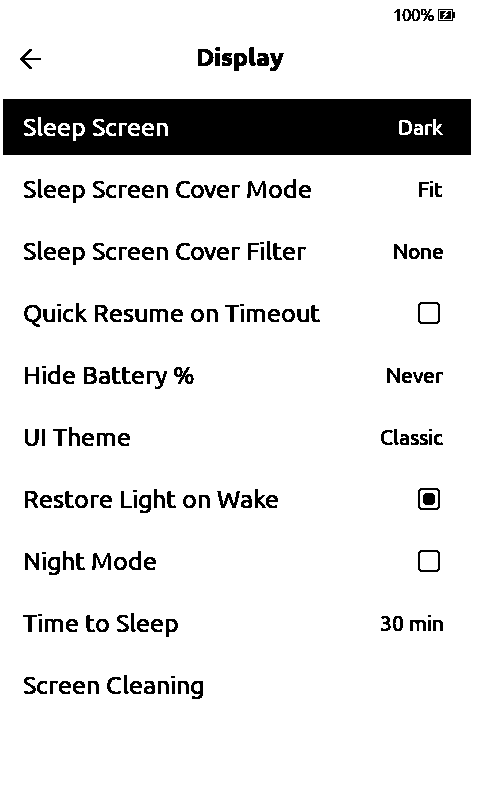
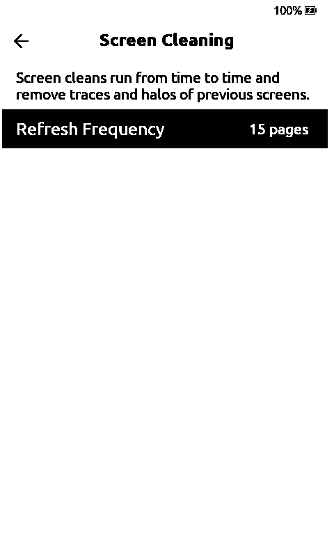
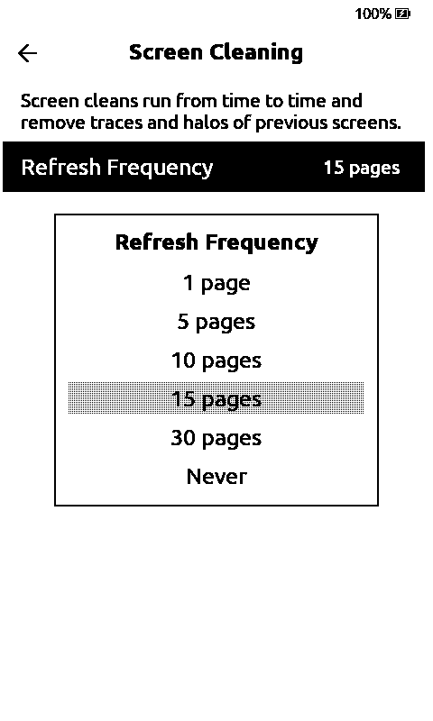

# Group screen refresh settings under Screen Cleaning

## Summary

* **Goal:** keep screen-maintenance options in one place with a short explanation.
* **What changes:** **Settings → Display → Screen Cleaning**, with **Refresh Frequency** and **Sunlight Fading Fix** moved there. Saved values, JSON keys and web settings stay compatible; Sunlight Fading Fix keeps its board restrictions. No refresh behavior changes.

| Display | Screen Cleaning | Refresh Frequency |
| --- | --- | --- |
|  |  |  |

## Scope Check

- [x] I have read SCOPE.md and ROADMAP.md.
- [x] This PR is **not** a new built-in theme.
- [x] This PR is **not** a new external network connector.
- [x] This PR is **not** an interactive app, writing tool, RSS/news/browser, media playback, or PDF feature.
- [x] The stock firmware does not already handle this well, **and** no other popular CrossPoint fork already does.
- [x] This PR does not touch `freeink-sdk/`, `lib/hal/`, the bootloader, OTA, or recovery code.

## Additional Context

* `default` (C3), `x4pro-gh_release` and the simulator build. In English and Russian: open the submenu, change Refresh Frequency, check the saved value, Back through Display → Settings → Home.
* Two follow-ups add options to this submenu: #<redraw-delay> and #<home-control-center>.

---

### AI Usage

Did you use AI tools to help write this code? _**YES**_
