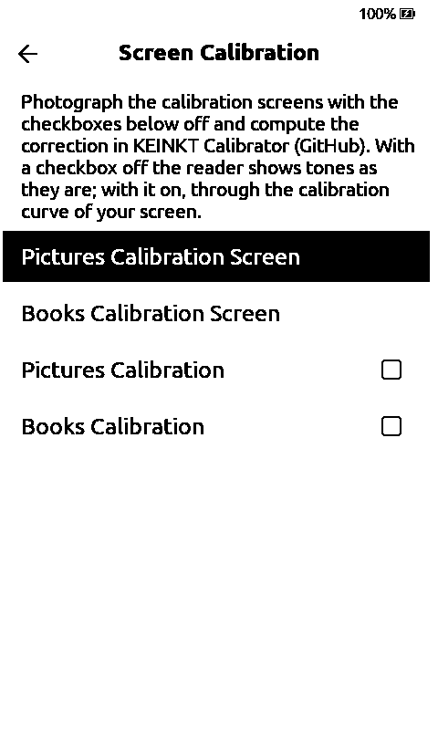
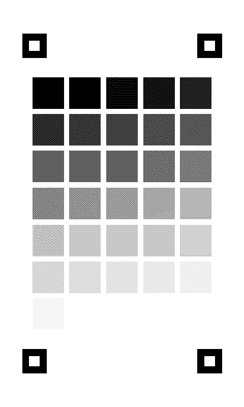
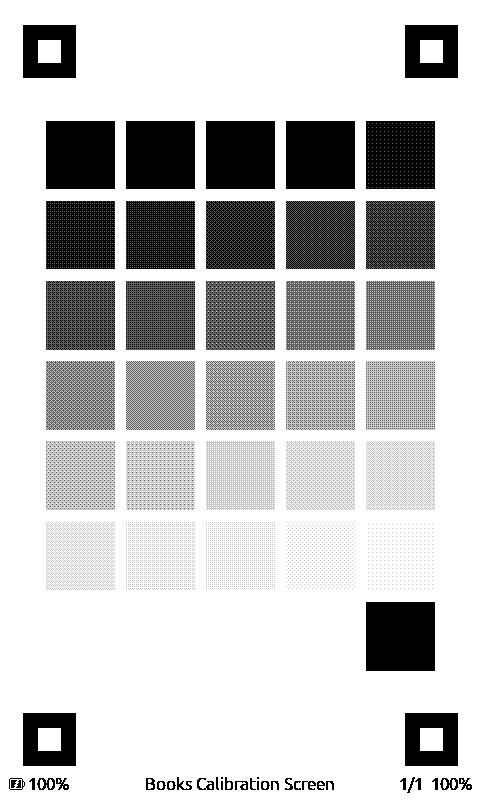
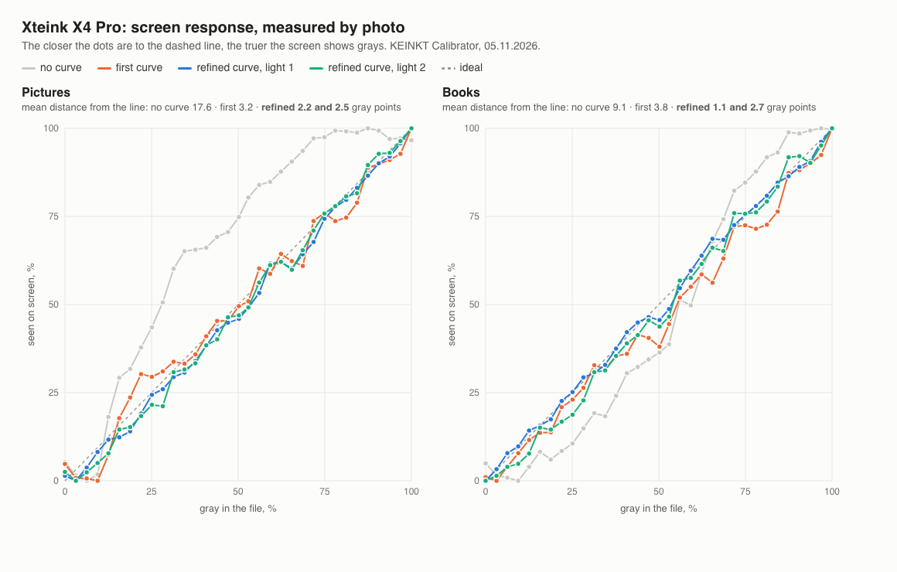
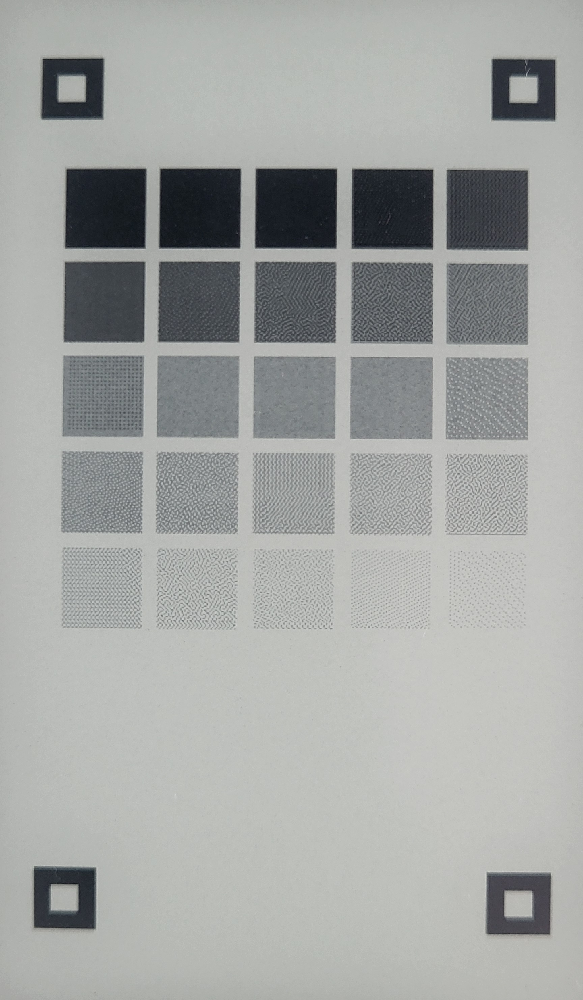
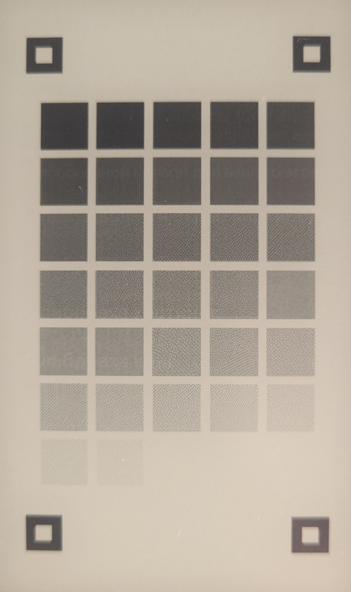
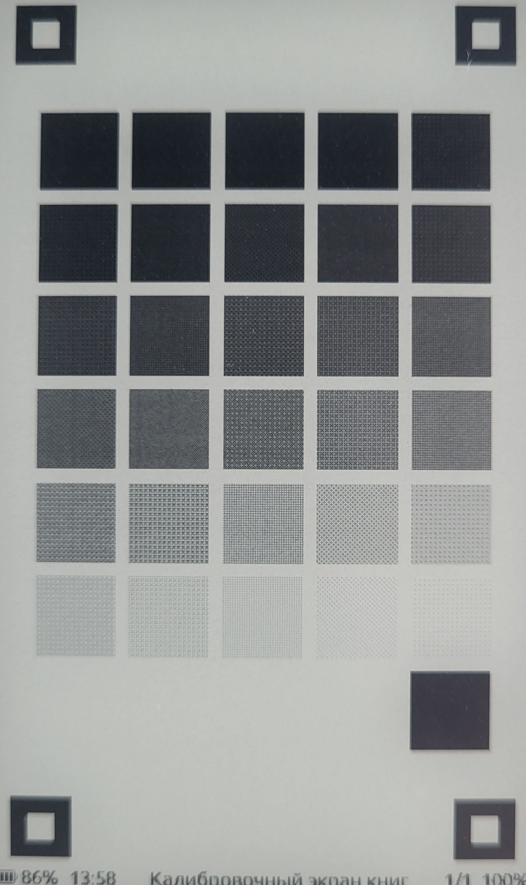
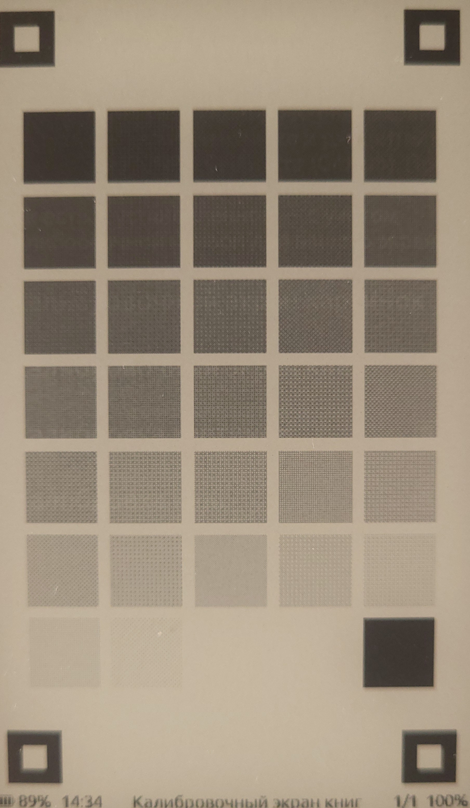

# Add separate screen calibration for pictures and book images

## Summary

* **Goal:** the same gray looks different on an e-ink panel than intended, and differently in pictures and in book images. Let a reader correct both for their own panel.
* **What changes:** **Display → Screen Calibration** with a pictures target and a books target, and two checkboxes that apply optional tone curves from the SD card: `/.crosspoint/panel_curve.txt` and `/.crosspoint/panel_curve_book.txt`. [KEINKT Calibrator](https://mikalaikryvusha.github.io/KEINKT/calibrator/) builds the curves from phone photos of the targets.
  * Both checkboxes default to Off; a checkbox reloads its curve at once. A missing or invalid file leaves tones unchanged. No curve measured on someone else's panel is built in.
  * Back from a target returns to the calibration menu; the targets do not replace the resumed book or enter Recent books.

| Screen Calibration | Pictures target | Books target |
| --- | --- | --- |
|  |  |  |

| Pictures: before | Pictures: with curve |
| --- | --- |
|  |  |

| Books: before | Books: with curve |
| --- | --- |
|  |  |

*Real photos of one X4 Pro, cropped without tone edits. Light and exposure vary between photos; the graph uses the measured, normalized response.*

## Scope Check

- [x] I have read SCOPE.md and ROADMAP.md.
- [x] This PR is **not** a new built-in theme.
- [x] This PR is **not** a new external network connector.
- [x] This PR is **not** an interactive app, writing tool, RSS/news/browser, media playback, or PDF feature.
- [x] The stock firmware does not already handle this well, **and** no other popular CrossPoint fork already does.
- [x] This PR does not touch `freeink-sdk/`, `lib/hal/`, the bootloader, OTA, or recovery code.

## Additional Context

* 912 host tests pass; `default` and `x4pro` build. Simulator: Back from both targets in all four orientations; a small BMP keeps its size with calibration Off and On.
* The same feature runs on my X4 Pro build; this upstream port itself has not been flashed yet.

---

### AI Usage

Did you use AI tools to help write this code? _**YES**_
