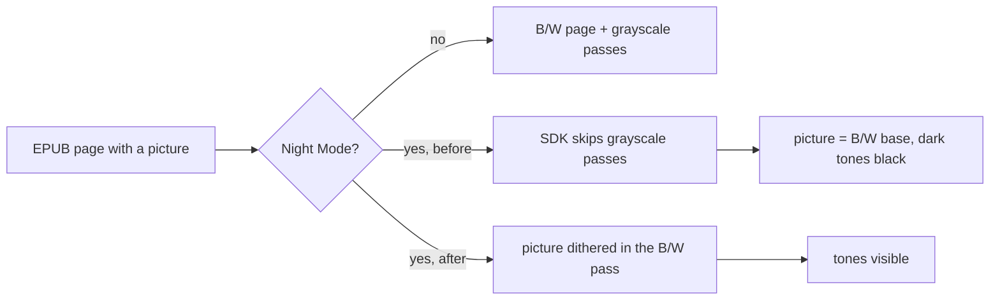

## Summary

* **Goal:** pictures inside EPUB books stay readable with **Night Mode** on.
* **Problem:** with **Images: Display**, a picture in Night Mode loses its dark and middle tones: they come out black. The SDK deliberately skips the grayscale passes on inverted output (`FreeInkDisplay::displayGrayBuffer` returns early when `_inverted`), so only the B/W base of the picture reaches the screen, and in that base the darker grays are plain black.
* **What changes:** in Night Mode the reader dithers EPUB pictures in the B/W pass, the same way **Images: Black & White** already does. Day mode is unchanged.

Simulator, `test/epubs/test_jpeg_images.epub` from this repo, chapters 2 and 3:

| Night Mode, before | Night Mode, after |
| --- | --- |
|  |  |

## Scope Check

- [x] I have read SCOPE.md and ROADMAP.md.
- [x] This PR is **not** a new built-in theme.
- [x] This PR is **not** a new external network connector.
- [x] This PR is **not** an interactive app, writing tool, RSS/news/browser, media playback, or PDF feature.
- [x] The stock firmware does not already handle this well, **and** no other popular CrossPoint fork already does.
- [x] This PR does not touch `freeink-sdk/`, `lib/hal/`, the bootloader, OTA, or recovery code.

## Additional Context

* One condition in `EpubReaderActivity::renderContents`: `imageGrayscale` is now also false when `screenInverted` is set. Picture polarity is kept by the existing B/W dither path.
* `x4pro`, `default` (C3) and the simulator build; 898 host tests pass.
* Running in my own X4 Pro build.

---

### AI Usage

Did you use AI tools to help write this code? _**YES**_
