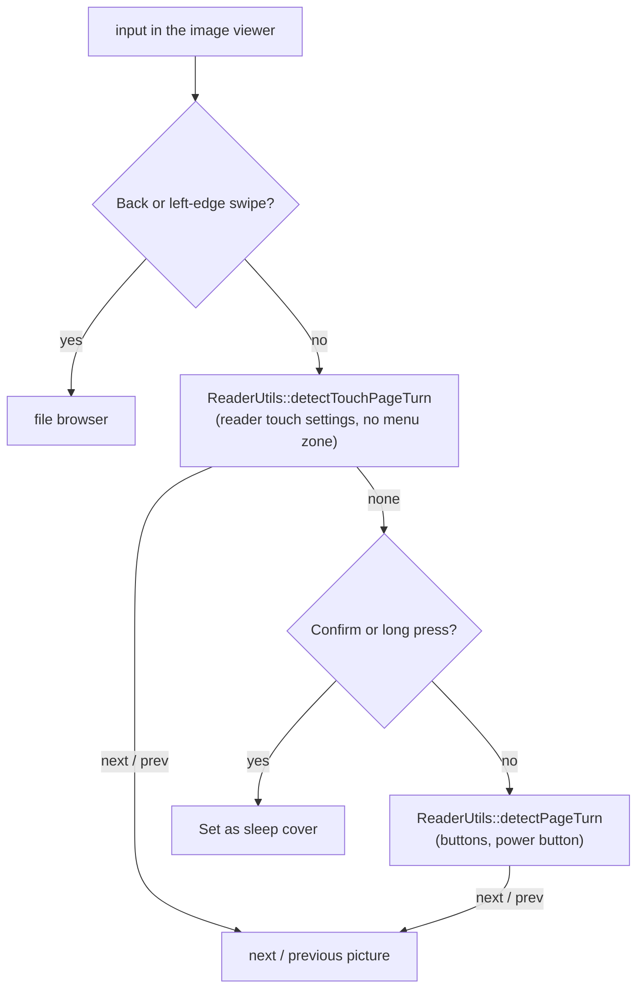

## Summary

* **Goal:** the image viewer turns pictures the way the reader turns pages, so the same hands and settings work in both.
* **What changes in the viewer:**

| Input | Before | After |
| --- | --- | --- |
| Touch | swipe left/right always, regardless of settings | follows **Touch Reader Controls** and **Next Page** / **Previous Page** (tap, swipe, both, inverted tap, off) |
| Tap on the screen | nothing | turns the picture when taps are enabled for page turns |
| Buttons | Left/Up previous, Right/Down next | the reader's mapping: front button swap, side button layout, and the power-button page turn when it is on |
| Back button, left-edge swipe | file browser | unchanged |
| Long press, Confirm | Set as sleep cover | unchanged |

Simulator, X4 Pro profile, default touch settings, the same input sequence on both builds:

## Scope Check

- [x] I have read SCOPE.md and ROADMAP.md.
- [x] This PR is **not** a new built-in theme.
- [x] This PR is **not** a new external network connector.
- [x] This PR is **not** an interactive app, writing tool, RSS/news/browser, media playback, or PDF feature.
- [x] The stock firmware does not already handle this well, **and** no other popular CrossPoint fork already does.
- [x] This PR does not touch `freeink-sdk/`, `lib/hal/`, the bootloader, OTA, or recovery code.

## Additional Context

* The viewer now calls the reader's own helpers in `ReaderUtils.h`, so there is no second copy of the page-turn rules. The center tap is not reserved, because the viewer has no reader menu.
* `x4pro`, `default` (C3) and the simulator build; 898 host tests pass.
* With **Touch Reader Controls** off, touch no longer turns pictures, the same as in books; Back and the left-edge swipe still exit.
* The page-turn part runs in my own X4 Pro build; there a long press rotates the picture, which is left out here.

---

### AI Usage

Did you use AI tools to help write this code? _**YES**_
